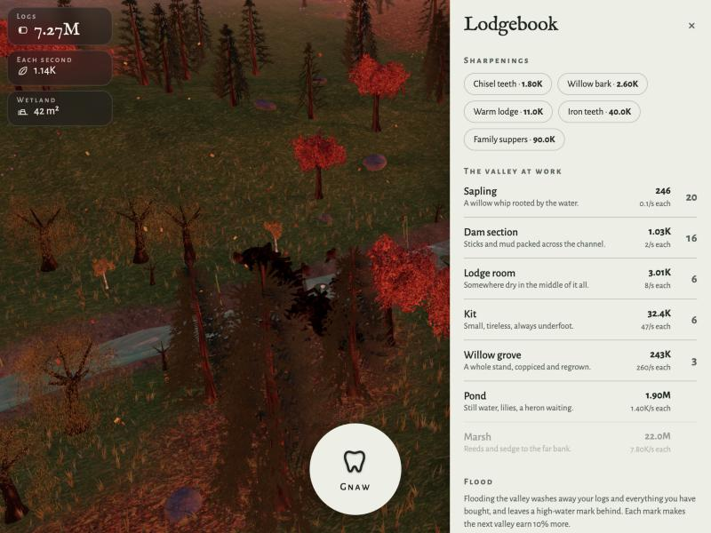

# Beaver Valley Idle

An incremental game played over a living valley. Gnaw to cut logs, then spend them
in the lodgebook on saplings, dam sections, lodge rooms, kits, groves, ponds and
marshes — and watch the three.js valley behind the interface actually build itself
as you buy. The water simulation is real: dam sections span the channel, the pond
backs up behind them, kits turn up and potter about mending it.

**▶ [Play it in your browser](https://jmorrisseyd.github.io/Beaver-Valley-Idle/)**

[](https://jmorrisseyd.github.io/Beaver-Valley-Idle/)

A fork of [Beaver Valley](https://github.com/jmorrisseyd/Beaver-Builder), which is
the same valley played directly, as a beaver.

## How it plays

- **Gnaw** — tap the disc (or hold space). Each gnaw is worth more as the valley earns more.
- **The lodgebook** — eight things to buy, each earning logs a second and each leaving
  something real behind: a sapling roots, a dam section goes across the channel, a lodge
  rises, a kit arrives.
- **Sharpenings** — one-off upgrades that multiply your gnaw or a particular building.
- **Flood the valley** — the prestige. Washes away your logs and everything you own, and
  leaves a high-water mark; each mark makes the next valley earn 10% more.
- **While you are away** — the valley keeps working, at half rate, for up to eight hours.

## Running it locally

One self-contained `index.html`. Serve the folder and open it:

```bash
python3 -m http.server
```

See [CLAUDE.md](CLAUDE.md) for the code map.
